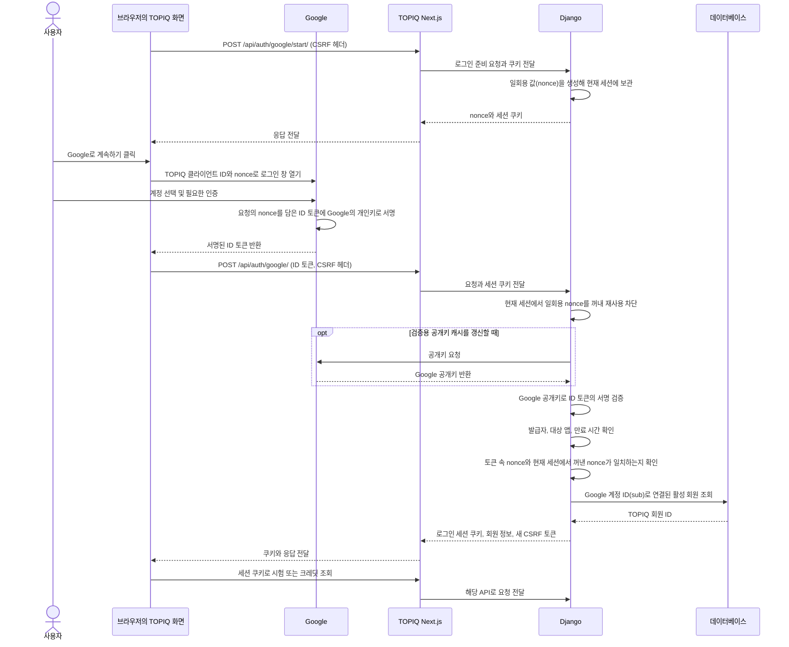

# TOPIQ Google 로그인 네트워크 흐름

이 흐름도는 이미 Google 계정을 연결한 회원이 TOPIQ에 다시 로그인하는 과정을 보여 준다.

사용자는 Google 로그인 창에서 본인 인증을 마친다. Django는 Google의 서명과 이번 로그인 요청의 일회용 값(`nonce`)을 검증하고, 토큰에 담긴 Google 계정 ID(`sub`)로 TOPIQ 회원을 찾는다. 로그인 후 브라우저는 Django가 발급한 세션 쿠키로 시험과 크레딧 API를 이용한다.

처음 Google로 로그인하면 Django가 검증 결과를 브라우저 세션에 15분간 보관하고 다음 단계를 안내한다.

- **기존 이메일 회원**은 연결할 이메일을 확인하고 TOPIQ 비밀번호를 입력한다. 브라우저가 `POST /api/auth/google/link/`를 보내면 Django는 비밀번호를 검증하고 해당 회원 ID에 Google 계정을 연결한다. 이후 같은 회원의 시험 기록과 크레딧을 이용한다.
- **신규 회원**은 닉네임·학습 설문·개인정보 동의를 입력한다. Google이 소유권을 보증하는 검증된 Gmail·Workspace 주소 외에는 같은 브라우저에서 TOPIQ 인증 메일을 확인한다. 마지막 `POST /api/auth/google/signup/` 요청에서 회원·연결·설문·가입 크레딧을 함께 저장한 뒤 로그인한다.
