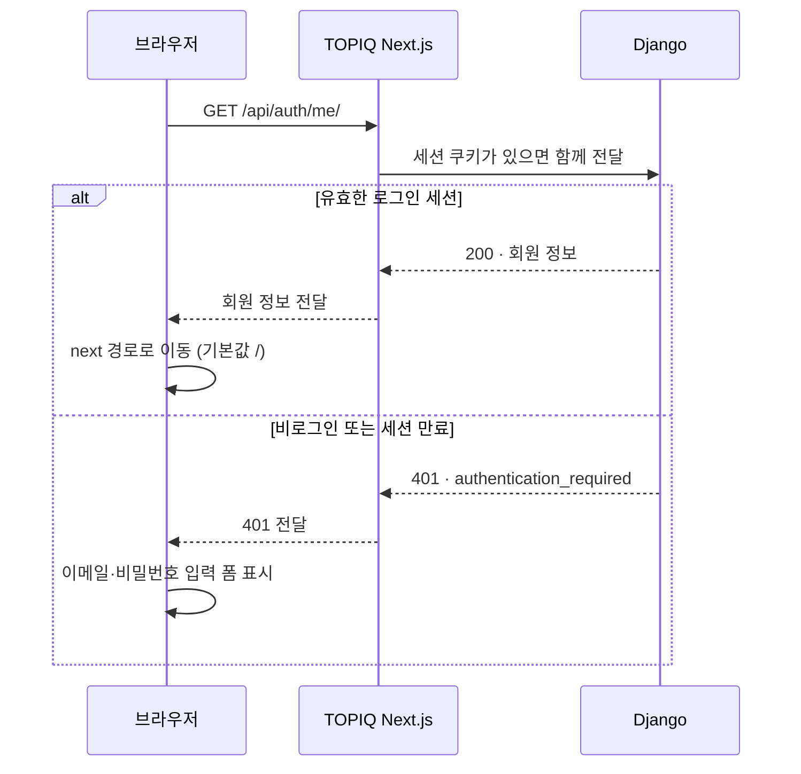
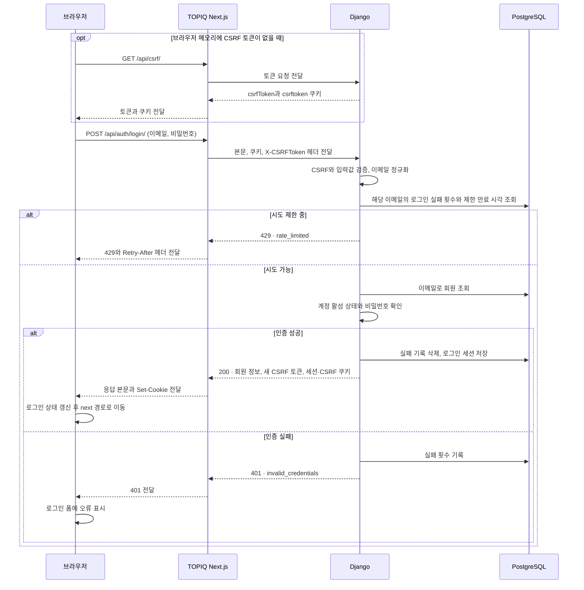

# TOPIQ 이메일·비밀번호 로그인 네트워크 흐름

브라우저는 TOPIQ와 같은 출처의 API를 호출하고, Next.js는 요청을 Django로 전달한다. **Google로 계속하기**를 선택했을 때의 요청은 [Google 로그인 흐름도](google-login-flow.md)에서 볼 수 있다.

## 1. 로그인 화면에서 기존 세션 확인

`/login`을 직접 열면 TOPIQ는 먼저 로그인 상태를 확인한다. 이미 앱 안에서 로그인 상태를 확인했다면 그 결과를 사용한다.

## 2. 비밀번호 확인과 세션 발급

- **세션 유지** — 성공 응답의 `user`로 화면을 갱신한다. 이후 요청에는 브라우저가 `sessionid` 쿠키를 보내고, CSRF 검사가 필요한 요청에는 프런트엔드가 새 토큰을 `X-CSRFToken` 헤더에 넣는다.
- **화면 복귀** — 로그인 화면의 `next`가 허용된 내부 경로이면 그곳으로 이동한다. 값이 없거나 유효하지 않으면 홈(`/`)으로 이동한다.
- **CSRF 재시도** — Django가 `403 csrf_failed`를 반환하면 브라우저는 갱신된 토큰으로 로그인 요청을 한 번 재시도한다.
- **로그인 시도 제한** — 같은 이메일로 5분 안에 5회 실패하면 제한 시간이 끝날 때까지 다음 요청에 `429`를 반환한다. `Retry-After`는 다시 시도할 수 있을 때까지 남은 초다.
