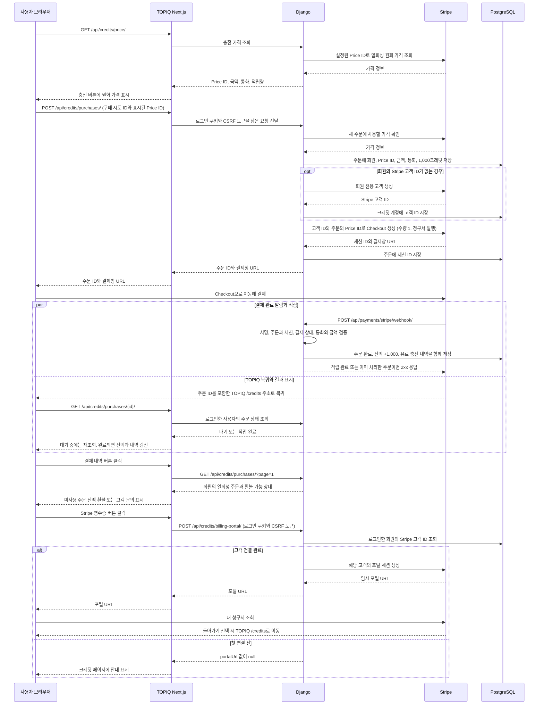
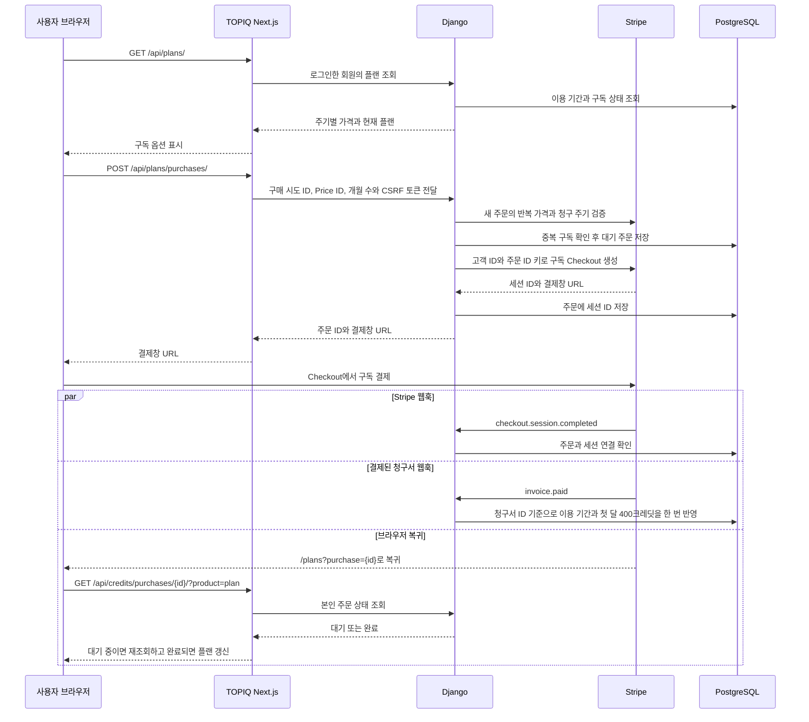
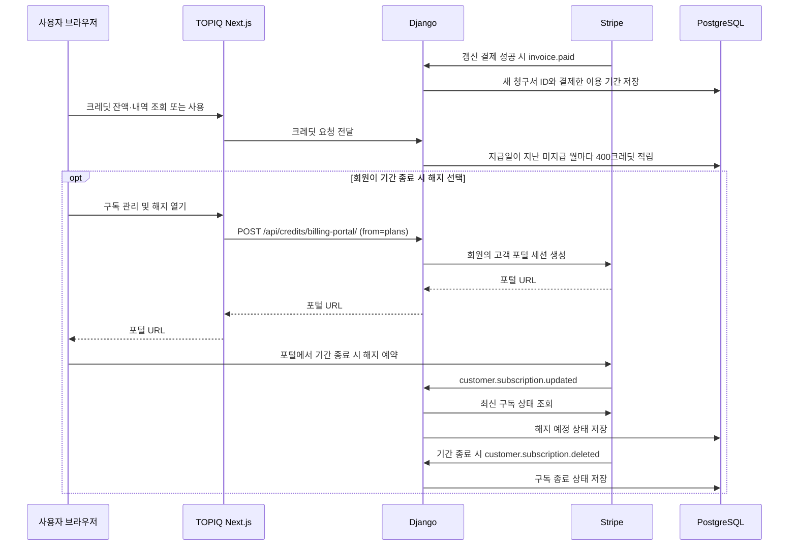
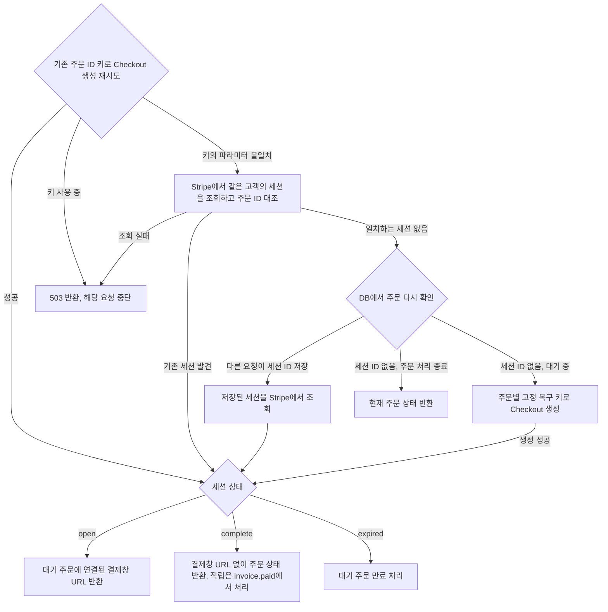

# TOPIQ 크레딧 충전과 Plus 구독 네트워크 흐름

[크레딧 충전](#크레딧-충전) · [Plus 구독](#plus-구독) · [결제창 재시도와 키 충돌 복구](#결제창-재시도와-키-충돌-복구) · [결제 유형별 환불·크레딧 차감 사례](stripe-credit-refund-cases.md) · [Stripe 환불 네트워크 흐름](stripe-credit-refund-flow.md)

## 크레딧 충전

로그인한 사용자가 TOPIQ의 `/credits`에서 Stripe에 등록된 원화 가격으로 결제하면 1,000크레딧을 적립한다. 예를 들어 백엔드의 `STRIPE_PRICE_ID`가 5,000원 가격을 가리키면 버튼과 Checkout 모두 5,000원을 표시한다. Django는 Stripe의 결제 완료 알림(웹훅)을 검증한 뒤 사용자의 잔액을 갱신한다.

### 결제 요청과 적립 기준

- **주문 생성.** 브라우저는 구매 시도 ID(`attemptId`)와 화면에서 확인한 `priceId`를 보낸다. 새 주문의 Price ID가 서버 설정과 달라졌으면 새 가격을 표시하고 다시 선택하도록 한다. 같은 구매 시도의 재전송에는 저장한 주문 조건을 사용한다. Stripe 세션 생성에는 주문 ID를 멱등성 키로 사용한다.
- **적립.** Stripe는 Django의 공개 HTTPS 웹훅 주소를 직접 호출한다. Django는 서명과 주문·세션 연결을 검증한 뒤, 완료된 세션의 `payment_status=paid`, 통화와 총액이 주문 시점에 저장된 값과 일치하는지 확인한다. 주문 완료, 잔액 1,000 증가, 거래 내역 생성을 같은 DB 트랜잭션으로 처리한다. 이미 적립된 주문은 중복 알림에 성공 응답만 반환한다.
- **결과 표시.** 웹훅과 브라우저 복귀는 어느 쪽이 먼저든 가능하다. 복귀 시점에 적립이 진행 중이면 주문 상태를 재조회한다. 완료되면 기존 `GET /api/credits/`와 `GET /api/credits/transactions/`로 잔액과 거래 내역을 다시 읽는다. 결제 직후 창을 닫아도 웹훅을 통해 적립된다.
- **결제 중단과 만료.** Checkout에서 결제를 취소하고 돌아오면 본인 주문 상태를 확인한다. 열린 세션은 재시도할 수 있다. Stripe가 세션 만료를 알리면 대기 주문을 만료 처리한다. 미결제 주문의 적립량은 0이다.

## Plus 구독

### 가입과 첫 결제

회원은 `/plans`에서 1개월(9,900원), 3개월(23,900원), 6개월(43,900원) 중 청구 주기를 선택한다. 결제창은 Stripe 대시보드의 결제수단 설정을 따른다. Django는 서명을 검증한 `invoice.paid` 웹훅에서 청구서의 고객·구독·가격·통화·금액을 주문과 대조한 뒤 이용 기간과 첫 달 400크레딧을 반영한다.

### 갱신과 해지

갱신 청구서가 다음 기간 시작 전에 도착해도 그 기간의 첫 400크레딧은 시작일이 되어야 지급 대상이 된다. 갱신 결제가 실패하거나 해지를 예약해도 이미 결제한 기간의 종료일까지 Plus를 이용할 수 있다.

### 결제창 재시도와 키 충돌 복구

같은 구독 주문에 세션 ID가 저장돼 있으면 Django는 그 세션을 직접 조회한다. 아래는 세션 ID가 없는 대기 주문을 생성 후 23시간 이내에 재시도하는 흐름이다. 23시간을 넘기면 기존 세션 복구만 시도하며, 조회에 성공해도 세션이 없으면 주문을 만료 처리한다.

복구 키는 `{주문 ID}-subscription-v2`다. 응답이 유실되거나 두 요청이 동시에 복구를 시도해도 같은 주문에는 같은 키를 쓴다. Stripe가 키 사용 중(`idempotency_key_in_use`)이라고 응답하면 Django는 503을 반환하고 해당 요청에서 복구 키로 새 세션을 만들지 않는다.

구독 흐름의 구현은 [결제창 생성과 재시도](../backend/accounts/payments.py), [청구서와 구독 웹훅](../backend/accounts/subscriptions.py), [월별 크레딧 지급](../backend/accounts/credits.py)에서 확인할 수 있다.

관련 자료는 [TOPIQ의 기존 API 전달 설정](../frontend-TOPIQ/next.config.ts), [기존 크레딧 모델](../backend/accounts/models.py), [Stripe Checkout 결제 완료 처리](https://docs.stripe.com/checkout/fulfillment)에서 확인할 수 있다.
