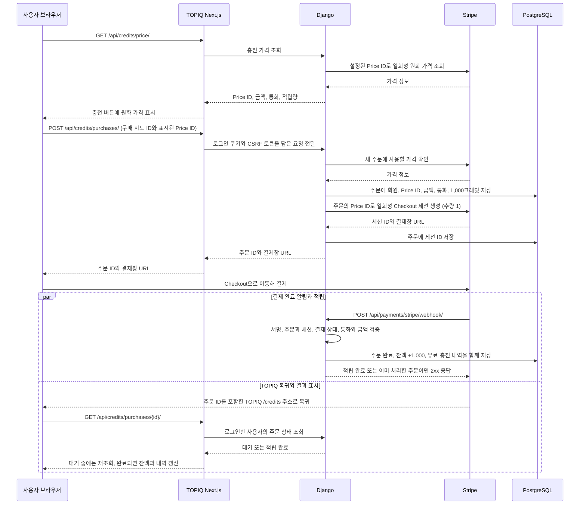

# TOPIQ 크레딧 충전 네트워크 흐름

로그인한 사용자가 TOPIQ의 `/credits`에서 Stripe에 등록된 원화 가격으로 결제하면 1,000크레딧을 적립한다. 예를 들어 백엔드의 `STRIPE_PRICE_ID`가 5,000원 가격을 가리키면 버튼과 Checkout 모두 5,000원을 표시한다. Django는 Stripe의 결제 완료 알림(웹훅)을 검증한 뒤 사용자의 잔액을 갱신한다.

## 결제 요청과 적립 기준

- **주문 생성.** 브라우저는 구매 시도 ID(`attemptId`)와 화면에서 확인한 `priceId`를 보낸다. 새 주문의 Price ID가 서버 설정과 달라졌으면 새 가격을 표시하고 다시 선택하도록 한다. 같은 구매 시도의 재전송에는 저장한 주문 조건을 사용한다. Stripe 세션 생성에는 주문 ID를 멱등성 키로 사용한다.
- **적립.** Stripe는 Django의 공개 HTTPS 웹훅 주소를 직접 호출한다. Django는 서명과 주문·세션 연결을 검증한 뒤, 완료된 세션의 `payment_status=paid`, 통화와 총액이 주문 시점에 저장된 값과 일치하는지 확인한다. 주문 완료, 잔액 1,000 증가, 거래 내역 생성을 같은 DB 트랜잭션으로 처리한다. 이미 적립된 주문은 중복 알림에 성공 응답만 반환한다.
- **결과 표시.** 웹훅과 브라우저 복귀는 어느 쪽이 먼저든 가능하다. 복귀 시점에 적립이 진행 중이면 주문 상태를 재조회한다. 완료되면 기존 `GET /api/credits/`와 `GET /api/credits/transactions/`로 잔액과 거래 내역을 다시 읽는다. 결제 직후 창을 닫아도 웹훅을 통해 적립된다.
- **결제 중단과 만료.** Checkout에서 결제를 취소하고 돌아오면 본인 주문 상태를 확인한다. 열린 세션은 재시도할 수 있다. Stripe가 세션 만료를 알리면 대기 주문을 만료 처리한다. 미결제 주문의 적립량은 0이다.

흐름을 수정할 때는 위 `mermaid` 코드 블록의 참여자와 화살표를 편집한다. GitHub에서 이 Markdown 파일을 열면 흐름도를 볼 수 있다.

관련 자료는 [TOPIQ의 기존 API 전달 설정](../frontend-TOPIQ/next.config.ts), [기존 크레딧 모델](../backend/accounts/models.py), [Stripe Checkout 결제 완료 처리](https://docs.stripe.com/checkout/fulfillment)에서 확인할 수 있다.
