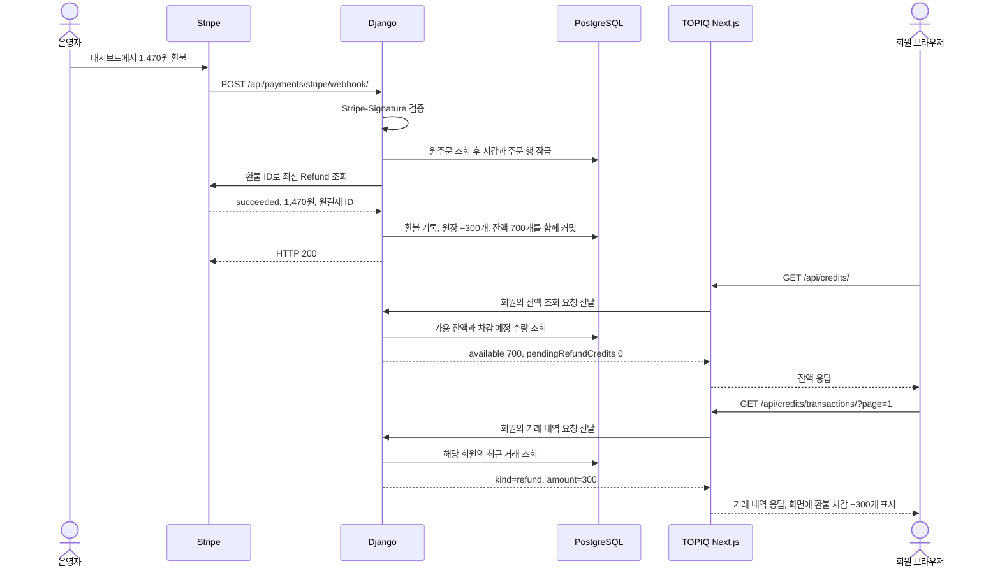
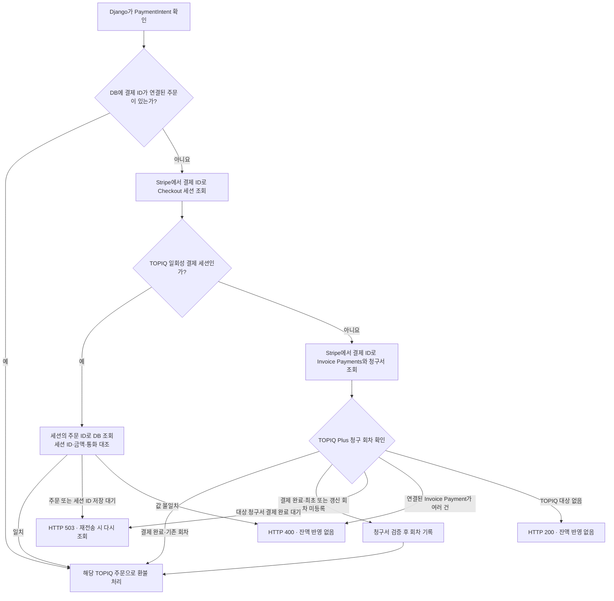
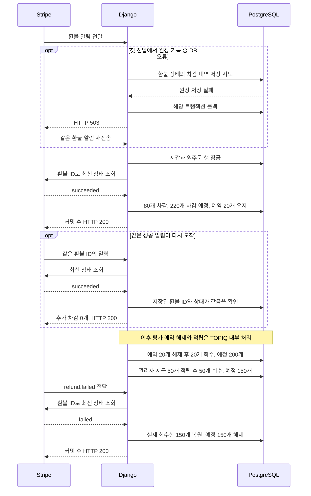

# TOPIQ Stripe 환불 네트워크 흐름

운영자가 Stripe에서 전액 또는 부분 환불을 실행하면 Stripe가 Django에 웹훅을 보낸다. Django는 원결제와 최신 환불 상태를 확인해 회원 지갑을 정산한다. 회원은 이후 TOPIQ의 `/credits`를 열거나 새로고침해 결과를 확인한다. 금액별 계산 예시는 [환불·크레딧 차감 사례집](stripe-credit-refund-cases.md), 최초 적립 과정은 [결제 흐름](stripe-credit-payment-flow.md)에 있다.

## 환불 실행부터 회원 화면까지

일회성 충전은 회원도 `/credits`의 결제 내역에서 주문별로 환불할 수 있다. 먼저 적립된 유료 충전부터 차감하므로, 전량 남은 주문만 직접 환불할 수 있다. 서버가 해당 크레딧을 보류한 뒤 Stripe에 원결제액 전액을 요청한다. 승인 응답과 웹훅은 같은 환불 ID로 정산한다. 일부 사용한 주문은 주문번호를 첨부해 `billing@unigate.kr`로 문의한다.

4,900원에 충전한 1,000개가 전부 남은 회원에게 1,470원(30%)을 환불한 경우다. Stripe의 웹훅 전송과 회원의 잔액 조회는 각각 독립된 요청이다. 아래는 정산이 끝난 뒤 회원이 화면을 연 순서다.

Django는 `refund.created`, `refund.updated`, `refund.failed`를 같은 웹훅에서 받는다. 정산에는 최신 상태가 `succeeded`인 환불액만 합산한다. 웹훅의 HTTP 200은 이벤트 처리가 끝났다는 뜻이므로, 대기 중인 환불을 기록하거나 이미 처리한 알림을 받았을 때도 반환한다. [웹훅 수신 코드](../backend/accounts/payments.py) · [회원 화면의 조회 순서](../frontend-TOPIQ/src/components/credits/CreditsAccount.tsx)

## 환불된 결제에서 TOPIQ 원주문 찾기

Django는 환불의 결제 ID(`PaymentIntent`)로 DB를 먼저 조회한다. 환불에 `Charge` ID만 있으면 Stripe에서 해당 결제 ID를 확인한다. Plus는 갱신 때마다 청구서가 바뀌므로, 같은 회원의 구독에서도 **환불한 청구서에 해당하는 회차**를 찾아야 한다.

- **일회성 환불이 적립보다 먼저 도착**하면, 원주문이 확인된 시점에 환불을 기록한다. 이후 결제 완료 알림(`checkout.session.completed`)에서 적립과 환불 차감을 함께 반영한다.
- **Plus 환불이 청구서 웹훅보다 먼저 도착**하면, Stripe에서 조회한 결제 완료 청구서로 회차를 먼저 기록할 수 있다. 뒤늦은 `invoice.paid`는 같은 청구서 ID로 중복 지급을 막는다. 시작 전인 갱신 회차는 첫 달 지급 시점에 환불 비율을 적용한다.
- **기능 도입 전 생성된 환불**은 원주문 조회 전에 처리를 끝낸다. 판정 기준은 해당 DB의 `accounts.0012_credit_refunds` 적용 시각과 Stripe의 환불 생성 시각이다. 도입 후 발생한 환불은 이전에 결제한 주문에도 적용된다. [원주문 검색과 환불 검증](../backend/accounts/refunds.py) · [Plus 청구서 처리](../backend/accounts/subscriptions.py)

## 잔액 부족, 웹훅 재전송, 환불 실패 후 복원

1,000개 충전 주문에서 30%를 환불해 **회수 대상이 300개**인 경우다. 회원은 보유 100개 중 20개를 평가에 예약해 두었으므로 즉시 회수할 수 있는 양은 80개다. 아래 흐름은 기술 오류로 같은 웹훅을 다시 받는 경우와, 이미 성공했던 **환불 자체가 실패**해서 지갑을 복원하는 경우를 보여준다.

이 예시의 최종 가용 잔액은 **150개**, 예약과 차감 예정은 각각 0개다. 같은 주문에 다른 성공 환불이 있으면 남은 성공액으로 회수 대상을 다시 계산해 초과 차감분만 복원한다. 여러 주문에 차감 예정분이 있으면 새 가용 잔액을 주문 생성 시각이 오래된 순서로 회수한다. [지갑 정산 코드](../backend/accounts/credits.py) · [중복 전달·롤백·복원 테스트](../backend/accounts/tests/test_credit_refunds.py)

| Stripe가 받은 응답 | Django에서 확인할 상황 |
|---|---|
| HTTP 200 | 정산 완료, 대기 상태 기록, 이미 처리한 상태, 도입 전 환불 또는 TOPIQ 대상이 없는 결제 |
| HTTP 400 | 웹훅 서명 검증 실패, 결제·통화·금액 불일치 등으로 이벤트를 거부 |
| HTTP 503 | 원주문 연결 준비 중, Stripe API 조회 실패, DB 오류 또는 웹훅 처리에 필요한 설정 누락. 원인이 해소된 뒤 재전송하면 같은 환불 ID로 다시 처리 |
